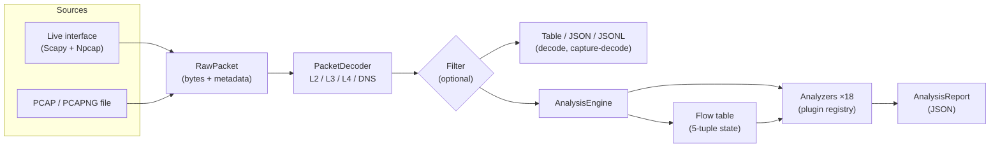

# Asphalt

**Packet capture, decode, and analysis for Windows-first network diagnostics.**

Asphalt captures live traffic through Scapy and Npcap, decodes packets from Ethernet up to DNS, and runs an extensible analyzer pipeline that turns raw packets into a structured JSON report. It ships as a command-line tool, a Python library, and a PySide6 desktop app that runs the same pipeline.

---

## Table of Contents

- [Why Asphalt](#why-asphalt)
- [Feature Overview](#feature-overview)
- [How It Works](#how-it-works)
- [Project Layout](#project-layout)
- [Requirements](#requirements)
- [Installation](#installation)
- [Quick Start](#quick-start)
- [CLI Reference](#cli-reference)
- [Filter Expressions](#filter-expressions)
- [Analyzers](#analyzers)
- [The Analysis Report](#the-analysis-report)
- [Using Asphalt as a Library](#using-asphalt-as-a-library)
- [Desktop UI](#desktop-ui)
- [Building a Windows Executable and Installer](#building-a-windows-executable-and-installer)
- [Testing](#testing)
- [Design Documentation](#design-documentation)
- [Known Issues](#known-issues)
- [Roadmap and Notes](#roadmap-and-notes)
- [Contributing](#contributing)

---

## Why Asphalt

Most packet tools stop at "here are the packets." Asphalt is built around the next question: **is this capture healthy, and what is it telling me?**

- **Deterministic by design.** Identical input files produce identical output, so reports can be diffed, archived, and compared across machines.
- **Best-effort decoding.** Malformed or truncated packets never crash the pipeline. They are kept and tagged with quality flags so you can see exactly what went wrong.
- **Modular analysis.** Each analyzer is an independent plugin with a small, fixed contract. Adding one does not touch the CLI, the engine, or the UI.
- **One pipeline, three front ends.** The CLI, the library API, and the desktop UI all run the same capture → decode → filter → analyze chain.

---

## Feature Overview

| Area | What you get |
|------|--------------|
| **Live capture** | Capture on any interface with an optional BPF filter, with per-interval stats (packets/sec, totals, drops). Stop after a fixed duration or with Ctrl+C. |
| **Interface discovery** | `asphalt capture -i list` prints every interface and the exact name to use, including Windows `\Device\NPF_{GUID}` names. |
| **Offline ingestion** | Reads classic PCAP and PCAPNG. The format is detected from the file extension or, failing that, the magic bytes. |
| **Protocol decoding** | Ethernet II, 802.1Q VLAN and QinQ, ARP, IPv4, IPv6, TCP (including MSS option parsing), UDP, ICMP, ICMPv6, and DNS over UDP and TCP. |
| **Decode quality flags** | Each packet carries flags such as `TRUNCATED`, `MALFORMED_L3`, `UNKNOWN_L4`, and `UNSUPPORTED_LINKTYPE`. |
| **OSI tagging** | Every packet is labelled with `l2:`, `l3:`, `l4:`, and `app:` tags, which power filtering and the UI's OSI controls. |
| **Packet filters** | A small expression language (`l4=tcp and dst_port=443`) that works in `decode`, `analyze`, and `capture-decode`. |
| **18 analyzers** | Capture health, TCP handshakes, retransmissions and RSTs, scan and ARP signals, DNS anomalies, throughput peaks, top talkers, and more. |
| **JSON reports** | A single, stable report shape for global, per-flow, and time-series results. |
| **Desktop UI** | A PySide6 app with capture controls, a packet overview grouped by IP version or L4 protocol, a dashboard, and one-click export. |
| **Windows packaging** | PyInstaller build script and an Inno Setup installer script that checks for Npcap at install time. |

---

## How It Works

Asphalt has one primary data flow. Live capture and offline files differ only at the first step.



### The stages

1. **Capture.** `capture.scapy_backend.ScapyBackend` sniffs packets on a background thread, queues them, and samples stats. Each packet becomes a `RawPacket`: an immutable record holding the raw bytes, a microsecond timestamp, captured and original lengths, the link type, and a `pcap_ref` locating it in its source.
2. **Decode.** `capture.decoder.PacketDecoder` parses headers and returns a `DecodedPacket`. It only reads headers, never unbounded payloads, and it never throws on bad input. Problems become quality flags.
3. **Filter (optional).** `utils.filtering` compiles an expression once and applies it to each decoded packet.
4. **Analyze.** `analysis.engine.AnalysisEngine` converts each packet into an `AnalysisPacket`, updates the flow table, and passes the packet to every active analyzer. When the input ends, `finalize()` merges all analyzer results into one `AnalysisReport`.

### Analyzer contract

Every analyzer subclasses `analysis.analyzers.base.Analyzer` and implements three hooks:

| Hook | When it runs | Purpose |
|------|--------------|---------|
| `on_start(context)` | Once, before any packet | Initialise state. Optional. |
| `on_packet(packet, flow_key, flow_state, context)` | For every packet | Accumulate counters and observations. |
| `on_end(context) -> AnalyzerResult` | Once, after the last packet | Produce the final result. |

Analyzers register themselves with `@register_analyzer`, and the CLI and UI select them by name.

---

## Project Layout

```text
Asphalt/
├── run.py                      # Preferred CLI runner from the project root
├── asphalt.py                  # Alternate CLI wrapper (setuptools entry)
├── asphalt_launcher.py         # Alternate CLI wrapper (adds src/ to path)
├── asphalt_cli.py              # Root shim; see Known Issues
├── asphalt.bat                 # Windows launcher: uses `asphalt` if installed
├── ui_app.py                   # PySide6 desktop application
├── debug_scapy.py              # Interface and Scapy diagnostics script
├── run_capture.py              # Minimal capture-only CLI group
├── pyproject.toml / setup.py   # Packaging (console script: `asphalt`)
├── requirements.txt            # Runtime dependencies (see Known Issues)
├── requirements-build.txt      # PyInstaller
├── build_exe.ps1               # PyInstaller build → dist/Asphalt.exe
├── build_installer.ps1         # EXE + Inno Setup installer
├── installer/Asphalt.iss       # Inno Setup script (checks for Npcap)
├── icon/                       # Application icon
│
├── src/
│   ├── asphalt_cli/            # Click commands: capture, capture-decode, decode, analyze
│   ├── capture/                # Live capture backends and packet decoder
│   │   ├── scapy_backend.py    #   Scapy sniffing, interface listing, stats
│   │   ├── packet_decoder.py   #   L2/L3/L4/DNS parsing and quality flags
│   │   ├── decoder.py          #   PacketDecoder façade
│   │   └── icapture_backend.py #   CaptureConfig and backend interface
│   ├── pcap_loader/            # Offline readers and session metadata
│   │   ├── pcap_reader.py      #   Classic PCAP
│   │   ├── pcapng_reader.py    #   PCAPNG (SHB / IDB / EPB / SPB)
│   │   ├── packet_index.py     #   Deterministic packet index records
│   │   └── session_manifest.py #   Deterministic session IDs and stats
│   ├── analysis/               # Engine, flow tracking, OSI tags, models
│   │   ├── engine.py           #   AnalysisEngine
│   │   ├── registry.py         #   @register_analyzer and factory helpers
│   │   ├── flow.py             #   Canonical 5-tuple flow keys
│   │   ├── osi.py              #   L2–App tag derivation
│   │   ├── models.py           #   AnalysisPacket, FlowState, AnalysisReport
│   │   └── analyzers/          #   The 18 built-in analyzers
│   ├── models/                 # RawPacket, DecodedPacket, PacketIndexRecord
│   └── utils/                  # Filter language, OUI vendor lookup, file/hash helpers
│
├── tests/
│   └── test_filter_expr.py     # Filter-language unit tests
│
└── docs/                       # Design notes and onboarding material
    ├── architecture.md         # Target-state system contract
    ├── codebase_map.md         # Onboarding map of the code
    ├── analysis.md             # Analysis subsystem reference
    ├── models.md               # Data-model explainer
    ├── packet_index.md         # Packet index explainer
    └── Creation Documentation/ # Development journal and notes
```

**Where to start reading:** `src/capture/packet_decoder.py` → `src/analysis/engine.py` → `src/analysis/analyzers/` → `src/asphalt_cli/analyze.py`. That path shows the whole pipeline from packet bytes to JSON report.

---

## Requirements

| Requirement | Version / Notes |
|-------------|-----------------|
| **Python** | 3.8 or newer is declared in `pyproject.toml`. The code was verified on Python 3.13. |
| **Npcap** | Required for **live** capture on Windows. Install it from [npcap.com](https://npcap.com/) and enable **WinPcap API-compatible mode**. Offline PCAP analysis does not need it. |
| **Administrator rights** | Live capture usually needs an elevated shell. |
| **Core Python packages** | `click>=8.0`, `scapy>=2.5` |
| **UI packages (optional)** | `PySide6` (required for the UI), `matplotlib` (optional; charts degrade gracefully without it) |

---

## Installation

From the project root, in PowerShell:

```powershell
python -m venv .venv
.\.venv\Scripts\Activate.ps1

pip install -r requirements.txt
pip install -e .
```

This installs the `asphalt` console command. For the CLI only, `pip install -e .` on its own is enough.

For the desktop UI, also install the UI extra:

```powershell
pip install -e ".[ui]"
```

> **Tip:** if you do not want to install anything, `run.py` works straight from the repository. Run `python run.py --help`.

Verify that Npcap can see your adapters:

```powershell
asphalt capture --interface list
```

Each entry prints a name. Copy that name exactly into `--interface`.

---

## Quick Start

```powershell
# 1. Find your interface
asphalt capture --interface list

# 2. Capture for 10 seconds, only HTTP traffic
asphalt capture --interface "Ethernet" --duration 10 --filter "tcp port 80"

# 3. Decode the first 20 packets of a capture file
asphalt decode capture.pcapng --limit 20

# 4. Keep only TCP packets to port 443, write JSON Lines
asphalt decode capture.pcapng --filter "l4=tcp and dst_port=443" --format jsonl --output https.jsonl

# 5. Run the full analyzer suite and save a report
asphalt analyze capture.pcapng --output report.json

# 6. Live capture and decode, streaming results
asphalt capture-decode --interface "Ethernet" --limit 50
```

If you are running from source instead of an installed package, replace `asphalt` with `python run.py`.

---

## CLI Reference

All commands are subcommands of `asphalt`. Run `asphalt <command> --help` for the full list.

### `asphalt capture`

Live capture with a running stats display. No decoding.

| Option | Short | Description |
|--------|-------|-------------|
| `--interface TEXT` | `-i` | Interface name, or `list` to print all interfaces. **Required.** |
| `--duration INT` | `-d` | Stop after N seconds. Default: run until Ctrl+C. |
| `--filter TEXT` | `-f` | BPF capture filter, for example `"tcp port 80"`. |

Prints a summary at the end: session ID, interface, duration, total packets and bytes, and drops.

### `asphalt capture-decode`

Live capture, decoded in real time.

| Option | Short | Default | Description |
|--------|-------|---------|-------------|
| `--interface TEXT` | `-i` | | **Required.** |
| `--duration INT` | `-d` | | Seconds to run. |
| `--filter TEXT` | `-f` | | BPF capture filter. |
| `--packet-filter TEXT` | | | Expression filter on decoded packets (alias: `--filter-expr`). |
| `--limit INT` | | `50` | Stop after N decoded packets. |
| `--show-quality` | | off | Show decode quality flags. |
| `--format` | | `table` | `table`, `json`, or `jsonl`. |
| `--output FILE` | | stdout | Write output to a file. |

### `asphalt decode`

Decode a PCAP or PCAPNG file.

| Option | Default | Description |
|--------|---------|-------------|
| `FILEPATH` | | **Required.** PCAP or PCAPNG file. |
| `--limit INT` | `50` | Maximum packets to decode. `0` means no limit. |
| `--show-quality` | off | Show decode quality flags. |
| `--format` | `table` | `table`, `json`, or `jsonl`. |
| `--output FILE` | stdout | Write JSON or JSONL to a file. |
| `--filter TEXT` | | Filter expression. |

### `asphalt analyze`

Run analyzers over a capture file and emit a JSON report.

| Option | Default | Description |
|--------|---------|-------------|
| `FILEPATH` | | **Required.** PCAP or PCAPNG file. |
| `--limit INT` | `0` | Maximum packets to analyze. `0` means no limit. |
| `--analyzers TEXT` | all 18 | Comma-separated analyzer names. See [Analyzers](#analyzers). |
| `--bucket-ms INT` | `1000` | Time-series bucket size in milliseconds. |
| `--chunk-size INT` | `200` | Packets per chunk for `packet_chunks`. |
| `--scan-port-threshold INT` | `20` | Unique destination ports before a source is flagged as scanning. |
| `--rst-ratio-threshold FLOAT` | `0.2` | RST ratio that triggers `abnormal_activity`. |
| `--filter TEXT` | | Filter expression applied before analysis. |
| `--format` | `json` | JSON is the only option today. |
| `--output FILE` | stdout | Write the report to a file. |

Example that runs a subset of analyzers with 500 ms buckets:

```powershell
asphalt analyze capture.pcap --analyzers global_stats,protocol_mix,tcp_handshakes,time_series --bucket-ms 500 --output report.json
```

---

## Filter Expressions

Filters are a small, safe expression language. They are compiled once, then evaluated per packet. No Python `eval` is involved.

### Fields

Every field in a decoded packet is available, such as `src_ip`, `dst_ip`, `src_port`, `dst_port`, `ttl`, `tcp_seq`, `dns_qname`, and `captured_length`. Four **OSI lenses** group the layers, and each is a list of tags:

| Lens | Values | Example |
|------|--------|---------|
| `l2` | `ethernet`, `arp` | `l2=arp` |
| `l3` | `ipv4`, `ipv6` | `l3=ipv6` |
| `l4` | `tcp`, `udp` | `l4=tcp` |
| `app` | `dns` | `app=dns` |

Two convenience aliases:

- `tcp_flag` matches TCP flag names in lowercase, such as `syn`, `ack`, `rst`, and `fin`. Example: `tcp_flag=syn`.
- `dns_rcode` accepts names or numbers. `NXDOMAIN` maps to 3. Example: `dns_rcode=NXDOMAIN`.

### Operators and logic

| Syntax | Meaning |
|--------|---------|
| `=`, `!=` | Equal, not equal. On a list field such as `tcp_flag` or `osi_tags`, `=` means "the list contains this value". |
| `~` | Contains, case-insensitive substring match. Example: `dns_qname~example`. |
| `<`, `<=`, `>`, `>=` | Numeric comparison. |
| `and`, `or`, `not` | Boolean logic. `not` binds tighter than `and`, and `and` binds tighter than `or`. |
| `( … )` | Grouping |

### Examples

```text
l4=tcp and dst_port=443
app=dns and dns_rcode=NXDOMAIN
not l3=ipv6
tcp_flag=syn and not tcp_flag=ack
src_ip=10.0.0.5 or dst_ip=10.0.0.5
captured_length>1000 and l4=udp
```

---

## Analyzers

Pass any of these names to `--analyzers`. With no list given, `asphalt analyze` runs all 18.

| Analyzer | What it reports |
|----------|-----------------|
| `capture_health` | Whether the capture can be trusted: quality, decode success rate, malformed and truncated counts, active filter, and sampling. Missing metadata appears as `n/a`. |
| `global_stats` | Totals, duration, IP-version and L4 distribution, and flag counts. |
| `protocol_mix` | Counts and percentages for TCP, UDP, ICMP, ICMPv6, and other. |
| `flow_summary` | Per-flow aggregates: packets, bytes, duration, and direction split. |
| `flow_analytics` | Flow summary plus heavy-hitter flows and a state classification for each flow. |
| `tcp_handshakes` | Groups SYN, SYN-ACK, and ACK into handshakes and measures their RTT. |
| `tcp_reliability` | Retransmissions, out-of-order segments, duplicate ACKs, and RST rate. |
| `tcp_performance` | Window sizes, zero-window events, and the MSS distribution. |
| `abnormal_activity` | Heuristics for malformed packets, high RST ratio, suspected port scans, and incomplete handshakes. |
| `scan_signals` | Scan-like behaviour: one source contacting many distinct destination ports. |
| `arp_lan_signals` | LAN anomalies from ARP traffic, such as one IP address claimed by more than one MAC address. |
| `dns_anomalies` | DNS anomalies, such as high-entropy query names, which can indicate tunnelling or generated domains. |
| `packet_chunks` | Fixed-size chunk summaries, useful for seeing how traffic changes over a capture. |
| `time_series` | Packet and byte counts per time bucket (`--bucket-ms`). |
| `throughput_peaks` | Current, average, and peak bits/sec and packets/sec, per bucket. |
| `packet_size_stats` | Captured and original length statistics, a size histogram, and fragmentation counts. |
| `l2_l3_breakdown` | Ethernet, VLAN, ARP, and ICMP counts, plus multicast and broadcast totals. |
| `top_entities` | Top IP talkers, top MAC talkers, and the most-used ports and services. |

---

## The Analysis Report

`asphalt analyze --output report.json` writes one JSON object with these top-level keys:

| Key | Contents |
|-----|----------|
| `capture_path` | Path of the analyzed file. |
| `created_at` | Report creation timestamp. |
| `stats` | `packets_total`, `bytes_captured_total`, `bytes_original_total`, `first_ts_us`, `last_ts_us`, `duration_us`. |
| `global_results` | One object per analyzer, for capture-wide findings. |
| `flow_results` | One object per analyzer, for per-flow findings. |
| `time_series` | Bucketed series from `time_series` and `throughput_peaks`. |
| `osi_summary` | Counts of OSI tags across the capture. |
| `analyzers` | Name and version of each analyzer that ran. |

Timestamps are microseconds since the Unix epoch, which keeps arithmetic exact. Output is deterministic: the same input produces the same report.

---

## Using Asphalt as a Library

Add `src/` to `sys.path`, or install the package with `pip install -e .`. The example below uses only the public API and was run against a sample capture.

```python
from analysis.engine import AnalysisEngine
from analysis.registry import create_analyzer, list_analyzers
from capture.decoder import PacketDecoder
from pcap_loader.pcap_reader import PcapReader

print(list_analyzers())  # all registered analyzer names

analyzers = [create_analyzer("global_stats"), create_analyzer("protocol_mix")]
engine = AnalysisEngine(analyzers, capture_path="capture.pcap")
decoder = PacketDecoder()

with PcapReader("capture.pcap") as reader:
    for raw in reader:
        engine.process_packet(decoder.decode(raw))

report = engine.finalize().to_dict()
print(report["stats"]["packets_total"], list(report["global_results"]))
```

Useful entry points:

| Object | Module | Role |
|--------|--------|------|
| `PacketDecoder` | `capture.decoder` | `decode(raw) -> DecodedPacket`. Never raises on bad input. |
| `PcapReader` / `PcapngReader` | `pcap_loader` | Iterate over `RawPacket` objects. Use as context managers. |
| `ScapyBackend` | `capture.scapy_backend` | `list_interfaces()`, `start(config)`, `get_packets()`, `get_stats()`, `stop()`. |
| `CaptureConfig` | `capture.icapture_backend` | Interface, BPF filter, snaplen, promiscuous flag, queue size. |
| `compile_packet_filter(expr)` | `utils.filtering` | Returns a predicate over decoded-packet dicts. |
| `filter_packets(packets, expr)` | `utils.filtering` | Applies a filter to a list of packets. |
| `register_analyzer` | `analysis.registry` | Decorator that adds a custom analyzer. |

### Writing a custom analyzer

```python
from analysis.analyzers.base import Analyzer
from analysis.models import AnalyzerResult
from analysis.registry import register_analyzer


@register_analyzer
class DnsQueryCounter(Analyzer):
    name = "dns_query_counter"
    version = "0.1"

    def on_start(self, context):
        self.queries = 0

    def on_packet(self, packet, flow_key, flow_state, context):
        if packet.dns_is_query:
            self.queries += 1

    def on_end(self, context) -> AnalyzerResult:
        return AnalyzerResult(analyzer=self.name,
                              global_results={"dns_queries": self.queries})
```

Import the module so the decorator runs, then pass `"dns_query_counter"` to `--analyzers` or `create_analyzer`. `AnalyzerResult` has three result buckets: `global_results`, `flow_results`, and `time_series`.

---

## Desktop UI

```powershell
python ui_app.py
```

The UI runs the same pipeline as the CLI and presents it as a dashboard:

- **Capture panel.** Interface (pre-filled with the first Wi-Fi or usable adapter), duration (default 10 s), packet limit (default 1000), and a BPF filter field. START and STOP drive a background capture with a progress bar.
- **Decode panel.** Open a PCAP or PCAPNG file, pick JSON or table output, and decode it.
- **Analyze panel.** Open a file and choose analyzers from a checklist, with bucket size and thresholds.
- **Stats header.** Packets, RST percentage, IPv4/IPv6 split, drops, TCP/UDP split, top protocol, flows, protocol mix, handshakes, DNS connections, and unique IPs.
- **Packet overview.** A tree grouped by IP version or L4 protocol, with OSI filter checkboxes (Ethernet, ARP, IPv4, IPv6, TCP, UDP, DNS).
- **Tabs.** Raw data, technical information, dashboard charts, and a searchable packet table.
- **Export.** Save the capture, or save the analysis report as JSON.

The UI reads its thresholds (drop rate, retransmission, RST, scan ports, and so on) from named constants at the top of `ui_app.py`. Change them there to tune what counts as a warning.

---

## Building a Windows Executable and Installer

**Single executable** (PyInstaller, produces `dist\Asphalt.exe`):

```powershell
.\build_exe.ps1
```

**Installer** (requires [Inno Setup](https://jrsoftware.org/isinfo.php) with `iscc.exe` on `PATH`):

```powershell
.\build_installer.ps1
```

The script builds the executable first, then compiles `installer\Asphalt.iss`. The installer creates a Start Menu entry and an optional desktop icon, and after installation it warns the user if Npcap is missing. Output goes to `installer\dist-installer\`, which is git-ignored.

---

## Testing

The repository includes a unit test suite for the filter language:

```powershell
$env:PYTHONPATH = "src"
python -m unittest tests.test_filter_expr -v
```

Run from the project root. The tests need `src/` on the path because they import `utils.filtering` directly. **Current status:** 4 tests, all passing.

Coverage is thin. The decoder, analyzers, and readers have no automated tests yet. Good first additions are a regression test for the PCAP padding issue in [Known Issues](#known-issues) and a small set of generated sample captures.

---

## Design Documentation

The `docs/` folder holds the design notes. Read them in this order:

| Document | What it covers | Status |
|----------|----------------|--------|
| [`docs/codebase_map.md`](docs/codebase_map.md) | A guided tour of the code and data flow, written for a new developer. | Mostly current. Some paths are stale; see Known Issues. |
| [`docs/analysis.md`](docs/analysis.md) | The analysis subsystem: analyzer contract, data models, and built-in analyzers. | Current. |
| [`docs/models.md`](docs/models.md) | Explains the data models (`RawPacket`, `PacketIndexRecord`, `SessionManifest`) in plain language. | Educational. |
| [`docs/packet_index.md`](docs/packet_index.md) | Explains what the packet index is for and how `pcap_ref` locates packets. | Educational. |
| [`docs/architecture.md`](docs/architecture.md) | A target-state system contract: privilege separation, storage tiers, queue budgets, threat model. | **Design target, not implemented.** See Roadmap. |
| `docs/Creation Documentation/` | Development journal entries. | Personal notes. |

---

## Known Issues

These were found while writing this README. Each was reproduced or confirmed by reading the code.

1. **Offline PCAP reading breaks on frames whose length is not a multiple of 4.**
   `src/pcap_loader/pcap_reader.py` lines 257–263 pad each record to a 4-byte boundary. Classic PCAP does not pad records; the 4-byte alignment belongs to PCAPNG blocks. The reader therefore skips two bytes too far and misreads the next record. A 54-byte frame file fails with `Packet 2 truncated`. The same file with 56-byte frames decodes and analyzes correctly. This affects `decode`, `analyze`, and the UI's PCAP path. **Fix:** remove the padding block. The notes in `docs/Creation Documentation/doc1.md` repeat the same mistake.
2. **`asphalt.bat` fallback does not work.** When `asphalt` is not installed, the batch file runs `src\asphalt_cli\main.py` directly. That module uses relative imports, so it fails with `attempted relative import with no known parent package`. Use `run.py` instead.
3. **`python -m asphalt_cli` fails from the project root.** The root-level `asphalt_cli.py` shadows the package. Use `run.py`.
4. **Some docs describe files that do not exist.** `docs/codebase_map.md` refers to `ui_server.py`, `ui/`, `ui-react/`, `src/capture/dummy_backend.py`, and `testing/`. None of these are in the repository. The current test directory is `tests/`.
5. **Two `SessionManifest` implementations.** `src/models/session.py` and `src/pcap_loader/session_manifest.py` both define one. The code map flags this; it is not yet consolidated.
6. **Version numbers disagree.** `pyproject.toml` and `setup.py` say `0.1.0`, while `installer/Asphalt.iss` says `1.0.0`.
7. **Unused dependencies.** `requirements.txt` lists `flask` and `flask-cors`, but no code imports them. The HTTP server they were meant for is not in the repo.
8. **No `LICENSE` file.** `pyproject.toml` declares `MIT`, but the repository has no license text.
9. **Scan-port threshold differs between CLI and UI.** The CLI default is `20`. The UI uses `SCAN_PORTS_WARN = 100`.
10. **Limited test coverage and untested paths.** The PCAPNG reader and the live Scapy backend have not been exercised in automated tests. The Python version floor (3.8) has not been checked against a 3.8 interpreter.
11. **No sample capture in the repository.** `docs/codebase_map.md` mentions `dhcp.pcapng` for tests, but the file is not checked in.

---

## Roadmap and Notes

`docs/architecture.md` describes a much larger target system than what exists today. It includes:

- A privileged capture service separated from the main process by authenticated IPC
- Three storage tiers: rotated PCAPNG files, a packet index with paging tokens, and an analytics database
- Bounded queues with explicit drop policies and Prometheus-style metrics
- An authenticated API gateway

None of that is implemented. Today Asphalt is a single-process tool with a CLI, a library, and a desktop UI. Treat `architecture.md` as the direction of travel, not a description of the current code.

Near-term priorities, based on the Known Issues above:

1. Fix the PCAP record padding and add a regression test.
2. Repair the `asphalt.bat` and `python -m asphalt_cli` entry points.
3. Add sample captures and tests for the decoder and analyzers.
4. Reconcile the version numbers, add a `LICENSE`, and remove unused dependencies.

---

## Contributing

1. Create a branch from `main`.
2. Keep each analyzer self-contained: one file, one `name`, one `@register_analyzer`.
3. Keep the decoder best-effort. It must never raise on malformed input. Report problems through quality flags.
4. Keep output deterministic. Avoid unordered iteration in anything that reaches the JSON report.
5. Run the tests (see [Testing](#testing)) before opening a pull request.

---

*Built with Scapy, Click, and PySide6.*
